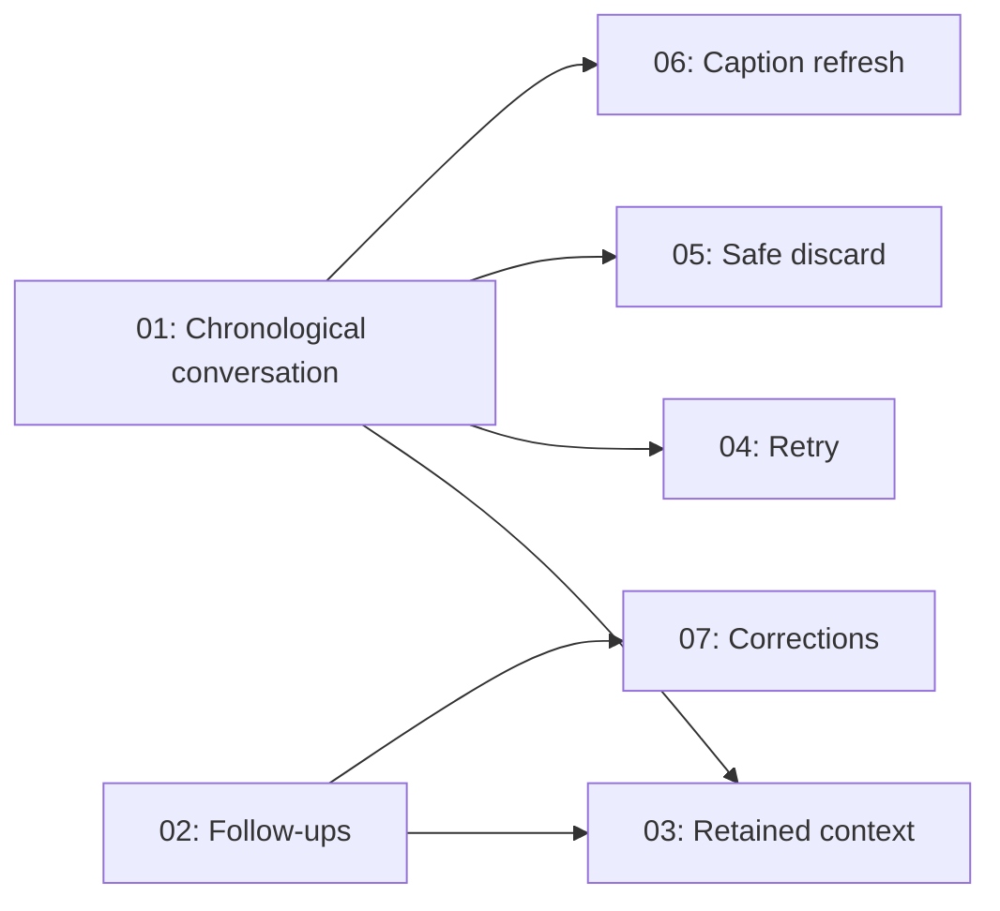

# Same-video chat execution guide

The [specification](spec.md) is the source of requirements. Each approved vertical slice has its own ticket; the specification is unchanged by publishing these tickets.

| Ticket | Blocked by | Primary acceptance criteria |
| --- | --- | --- |
| [01: Chronological conversation](issues/01-chronological-conversation.md) | None | AC01, AC05, AC14, AC19 |
| [02: Conversational follow-ups](issues/02-conversational-follow-ups.md) | None | AC02–04, AC09–10 |
| [03: Retained conversation context](issues/03-retained-conversation-context.md) | 01, 02 | AC06–08 |
| [04: Explicit failure Retry](issues/04-explicit-failure-retry.md) | 01 | AC12–14 |
| [05: Safe conversation discard](issues/05-safe-conversation-discard.md) | 01 | AC15 |
| [06: Caption refresh confirmation](issues/06-caption-refresh-confirmation.md) | 01 | AC16–18 |
| [07: Evidenced answer corrections](issues/07-evidenced-answer-corrections.md) | 02 | AC11 |

AC20 is a regression requirement for every slice, not a deferred cleanup ticket. Each slice includes its own tests and must leave the application verifiable; no separate prefactoring ticket is necessary.

## Dependency graph

## Parallel execution

- Start 01 and 02 immediately; neither depends on the other's presentation or backend changes.
- Once 01 is complete, 04, 05, and 06 are eligible, alongside any unfinished independent work.
- Once 02 is complete, 07 is eligible.
- Once both 01 and 02 are complete, 03 is eligible alongside other unblocked tickets.
- Readiness status does not override blockers: start a ticket only after all its blockers are complete.

These are behavior dependencies, not promises of conflict-free edits. The application is small and several tickets touch shared UI, service, and test code. Coordinate integration and review each combined result; shared files alone do not justify adding artificial blocking edges. Do not build generic coordination abstractions for these tickets.

## Verification boundary

Prefer Streamlit AppTest for complete viewer flows and the existing backend question/preparation service seams for failures, evidence, idempotency, and isolation that the UI cannot reliably expose. Use synthetic fixtures, mocked captions and model calls, mocked dotenv loading, and temporary stores/configuration; never use real local credentials in tests.

Run the documented dependency compatibility, compilation, and full unittest checks for each completed slice. Keep privacy, citation, consent, deletion, and spending/request regressions green. Mocked tests do not prove real reference resolution or factual entailment. Real conversational quality remains a separate owner-triggered review under the existing verified-price and spending rules; no live paid calls are authorized by ticket publication.
