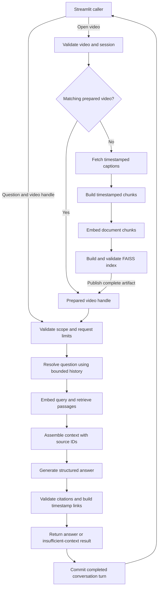

# VidSage backend pipeline plan

November 24, 2026 · Proposed design and implementation sequence

## Architecture decision

Organize the existing Python backend around two entry points, **prepare a video** and **answer a question about a prepared video**. Preparation produces a reusable, timestamped index. Question answering reads that index and returns an answer whose citations lead back to the original captions.

Use modules within one deployable application for the first private release. Keep Streamlit as the caller, FAISS as the index, and LiteLLM as the provider integration. The boundaries below let each stage be evaluated and changed independently. They also give a future HTTP API clear operations to expose if a separate frontend becomes necessary.

This plan develops the [product design brief](product-design.md). The proposed first release handles one captioned video per conversation and keeps prepared data within its session. Durable storage and cross-session reuse are later decisions with explicit triggers below. These are design choices for discussion.

## Current backend and why it needs boundaries

The current graph is `START → fetch_transcript → our_agent → END`. The first node downloads captions, joins them into text, splits that text, embeds all chunks, builds FAISS, and retrieves context. Every question repeats those preparation steps. Joining caption text discards its timestamps. The second node generates an answer and permits general-knowledge fallback. History is displayed in Streamlit but is absent from model input.

`ModelEmbeddings` already provides document/query embedding methods, bounded batching, and response-order validation. `model_config` already resolves server-owned provider settings. Reuse these capabilities. The retrieval option is currently misspelled `search_kwags`, so its supplied setting is ignored. These observations come from the reviewed [main.py](https://github.com/sujalnitk/VidSage/blob/2aaf2a2bedd7839ed9ffbc49529e831ce2b18c7b/main.py#L25) and [llm.py](https://github.com/sujalnitk/VidSage/blob/2aaf2a2bedd7839ed9ffbc49529e831ce2b18c7b/llm.py#L28).

The distinction is straightforward. **Indexing** prepares searchable data when a source or its processing settings change. **Retrieval** selects evidence for a particular question. **Generation** writes the answer using that evidence. LangChain documents these building blocks and the predictable retrieve-then-generate RAG flow. The module layout and rollout below are recommendations for VidSage. [LangChain retrieval guide](https://docs.langchain.com/oss/python/langchain/retrieval)

## End-to-end flow

Each box is a responsibility. Several boxes can remain ordinary functions within the same module. Initial preparation failure returns a typed error and requires a successful preparation before questions can run. A failed refresh preserves the previously ready version. An answer-generation failure leaves the prepared index available for another attempt.

## Pipeline A — source ingestion

**Trigger:** opening a video, changing its caption language, or explicitly refreshing its source.

**Input:** session identity, pasted YouTube URL or video ID, and requested caption language.

**Output:** a `TranscriptSnapshot` containing the canonical video ID, selected language, generated-caption flag, fetch time, source version, and ordered caption segments.

Responsibilities and decisions:

1. Parse recognized YouTube watch/share URLs locally and extract the ID. Fetch through the transcript client using that ID. Apply video-size and request limits before paid preparation work.
2. Select the requested caption track. If it is unavailable, report available choices or an unavailable-caption result. Record the language actually used.
3. Preserve each segment's text, start time, duration, and position in the snapshot. Keep the source text available for citation excerpts even if a normalized copy is used for retrieval.
4. Compute a source version from the selected track metadata and ordered segment content/timing. A timestamp alone cannot identify whether captions changed.
5. Distinguish missing/disabled captions from temporary access failures. Retry transient failures within a deadline. Permanent unavailability ends preparation before embedding.

The transcript library exposes caption text and timing together, and its maintainer documents IP blocking on hosting platforms. Verify caption availability on the intended host during the private pilot. A successful laptop fetch does not establish a hosted success rate. [Transcript API documentation](https://github.com/jdepoix/youtube-transcript-api#api), [maintainer deployment discussion](https://github.com/jdepoix/youtube-transcript-api/discussions/381)

**Cause and effect:** preserving timing at ingestion makes a returned passage traceable. Attempting to recover timing after flattening the text adds ambiguity, especially when the speaker repeats a phrase.

## Pipeline B — chunking and indexing

**Trigger:** a valid transcript snapshot without a matching ready index.

**Input:** the snapshot, chunking policy, and server-selected embedding profile.

**Output:** an immutable `PreparedVideo` artifact containing chunks, their source metadata, an embedding/index manifest, and the FAISS index.

| Stage | Responsibility | Boundary condition |
| --- | --- | --- |
| Chunking | Group adjacent caption segments into retrievable passages. Start by evaluating the existing 1,000-character target and 200-character overlap while carrying segment references through splitting. | If a long segment must be split internally, retain its original time range. Caption timing supports passage-level links, so the backend should report that precision honestly. |
| Document embedding | Reuse `ModelEmbeddings.embed_documents`. Preserve batching and response-order validation, and enforce the selected provider's input/token limits. | Empty captions, missing vectors, inconsistent dimensions, or invalid vectors prevent publication. Keep any successful intermediate work private to the preparation attempt. |
| Index construction | Build FAISS from vectors and timestamped chunk documents. Record vector count, dimension, distance metric, and normalization policy. | Validate that every vector maps to exactly one stored chunk before exposing the artifact. |
| Publication | Replace the session's prepared-video reference only after the complete artifact passes validation. | Readers see a ready artifact or a preparation status. A partially built index cannot become the active version. |

Assign each chunk an ID derived from its source version, chunking policy, and ordinal. Store its text, segment references, start/end times, and language beside that ID. Overlapping chunks may cite the same caption segments. The context assembler will consolidate duplicate evidence.

### Reuse and invalidation

A matching artifact requires the same video ID, track/language, source version, chunking policy/version, and embedding profile. The embedding profile includes provider/deployment identity, model revision where available, vector dimension, document/query task settings, and normalization/distance policy. Credentials remain server configuration and are excluded from artifact metadata.

- A second question reuses the artifact and embeds only its query.
- A chat-model change can reuse the index if the embedding profile is unchanged.
- An embedding-model change requires a new index, even when vector dimensions happen to match.
- A caption refresh creates a new source version if content or timing changed. Existing requests finish against their pinned version. New conversations/questions can switch to the new ready version explicitly.

Keep the first implementation's artifacts in session memory. Give each session a bounded number and total size, and evict them when the video closes or the session expires. Later, a durable cache needs a freshness policy and deletion behavior before it can safely reuse transcripts across sessions.

**Cause and effect:** indexing once removes repeated transcript downloads and document-embedding charges from follow-up questions. Versioned reuse prevents speed improvements from silently mixing incompatible vectors or outdated citation times.

## Pipeline C — question resolution and retrieval

**Trigger:** a question targeting a ready video handle.

**Input:** session identity, prepared-video/version handle, original question, and bounded recent conversation turns for that same video.

**Output:** ranked `RetrievedPassage` records carrying chunk IDs, source text/times, index version, rank, score, and score interpretation.

The retrieval sequence is:

1. Validate ownership/session scope, video readiness, question length, and request budget. Select the artifact by the server-held handle.
2. Use the original question directly for a standalone request. When follow-up support is introduced, resolve references such as “that example” using bounded history. An unresolved reference should yield a clarification request. Preserve the original question for the final answer.
3. Embed the search query with the artifact's compatible query-embedding profile. Changing the server embedding settings cannot cause a question to use new vectors against an old index.
4. Search that video's FAISS index. Begin with an explicit, working `k=4`, then compare candidate counts on labeled questions.
5. Return passages and their scores to the next stage. The retriever's output is evidence selection, so it contains source records rather than a generated answer.

FAISS nearest-neighbor results can include weakly related material. A score is useful for diagnostics, but its meaning depends on the metric, embedding model, and normalization. Calibrate any rejection threshold on labeled answerable/unanswerable questions for that profile. A universal confidence percentage would obscure these differences.

Add keyword/dense hybrid search or reranking only if the evaluation set shows a particular failure, such as missing an exact technical term or placing the correct passage below the context limit. Each additional stage needs a measured recall improvement that justifies its latency and maintenance cost.

**Cause and effect:** a standalone retrieval stage makes “the answer is wrong” diagnosable. We can inspect whether the supporting passage was retrieved before changing the generation model.

## Pipeline D — context assembly

**Input:** the original question, resolved search query, ranked passages, and bounded same-video conversation context.

**Output:** a `RetrievedContext` with the exact source-ID-to-passage mapping sent to the model.

- Consolidate overlapping passages and repeated caption spans while preserving their source references.
- Where a passage starts mid-explanation, include a neighboring span within the context budget and register it as an available source too.
- Budget input tokens for instructions, history, evidence, and reserved answer capacity using the configured model's limits. Drop lower-ranked evidence deterministically when needed.
- Label source passages clearly. Treat caption contents as untrusted source data, including instructions a speaker might read aloud. The server's answer rules remain separate from that text.
- Keep previous assistant answers as conversational context. Only source passages can support a new factual claim about the video.

An empty usable context returns `insufficient_context` without a generation call. Nonempty retrieved text still requires the model to judge whether it answers the question.

## Pipeline E — generation and citation validation

**Input:** original question and assembled context, plus the server-owned chat configuration.

**Output:** an `AnswerResult` with status, claims, and resolved citation records, or a typed generation error.

Request an answer structured as claims with source IDs. Require transcript-supported claims and an explicit insufficient-context outcome. The generation model receives source IDs and passages, while the backend owns the mapping from IDs to timestamps and video links.

Validation checks that the response has a supported status, that answered claims contain text and source references, and that every referenced ID belongs to the context supplied for this request. Reject malformed or unknown-source output with `generation_failed`. Return a deliberate insufficient-context result as a normal completed outcome.

For valid citations, build the displayed excerpt and playback link from stored source metadata. Use the original passage start time, rounded down to whole seconds for the link. Preserve the exact caption excerpt for comparison with the claim.

**Structural citation validation cannot prove that a passage supports the claim.** Human-labeled evaluation must check entailment and useful timestamp alignment. Track this separately from whether the model returned a valid source ID.

Start with one generation call per standalone question. Follow-up resolution can add a call when introduced. Any later repair or verification call must have a fixed attempt limit and be included in latency and cost measurements.

## Pipeline F — conversation and request completion

Commit the user question, validated result, cited artifact version, and request ID together only after a completed answer or intentional insufficient-context result. Keep failed attempts in operational status so they cannot appear as successful conversation turns.

Use a per-session conversation ID and a per-submission request ID. A completed duplicate submission returns its stored result. A duplicate still in progress returns its status. Pin each conversation to a video and source version, and ignore late results if the user has switched videos or cleared that conversation. History passed to the next request is bounded by turns and tokens.

Initially, pass explicit history into the query workflow and keep it in session state. If durable resume becomes necessary, LangGraph checkpointers provide thread-scoped state. Transcript/index storage has a separate lifecycle from conversation checkpoints. [LangGraph persistence guide](https://docs.langchain.com/oss/python/langgraph/persistence)

## Shared data contracts

These are proposed records for the module boundaries, expressed independently of a particular database or HTTP framework.

| Record | Required information |
| --- | --- |
| `TranscriptSnapshot` | Video ID, selected track/language, generated-caption flag, fetched time, source version, ordered text/start/duration segments |
| `Chunk` | Chunk ID, snapshot version, ordinal, source segment references, text, start/end seconds, language |
| `PreparedVideo` | Session-scoped handle, source/chunking/embedding versions, chunk map, FAISS index, dimension/metric/normalization, readiness |
| `QuestionRequest` | Request ID, session/conversation IDs, prepared-video/version handle, question, bounded prior turns |
| `RetrievedPassage` | Chunk/source version, text, time range, rank, score, metric identity |
| `RetrievedContext` | Original/resolved question, exact supplied source mapping, bounded history and token usage |
| `AnswerResult` | Request ID, status, claims with source IDs, resolved excerpts/timestamps/URLs, artifact version |

For example, a question about repeated requests retrieves a chunk covering 18:42–19:03. That chunk's ID travels through retrieval, context, generation, and validation. The server resolves the cited ID back to 18:42. A subsequent question uses the same prepared index and a fresh query embedding. This example is illustrative.

## State, failure handling, and storage ownership

Preparation progresses through `unprepared → fetching → indexing → ready`, with a `failed` outcome carrying a safe error category. A matching in-progress preparation is reused within the session. Use a lock around preparation ownership and publication so duplicate opens cannot build and publish competing copies.

| Condition | Backend behavior |
| --- | --- |
| Invalid link, empty question, or exceeded size limit | Reject at admission before paid work. Normalize only supported YouTube inputs. |
| Captions unavailable | Mark preparation failed with a permanent source category. Offer another video or supported language. |
| Transient transcript/provider failure | Enforce a total deadline and bounded retry/backoff. Honor rate-limit guidance. Coordinate SDK and application retries to cap total attempts. |
| Invalid provider configuration or vector mismatch | End the attempt with an operator-actionable category. Preserve any previously ready artifact. |
| Generation/citation failure | Preserve the index and return a safe failure. An explicit subsequent question can reuse it. |
| Unsupported question | Return a completed insufficient-context result. Keep this distinct from service failure in metrics. |

Provider timeouts can happen after a request has been billed. Request deduplication prevents repeated local completion, but it cannot guarantee exactly-once provider billing. Budget retries as potentially paid attempts.

The service coordinates admission limits, maximum concurrent provider requests, request deadlines, and spend reservations. Reconcile reservations with reported usage, and record missing usage as estimated/unknown. A process-wide limiter is sufficient for the single-process pilot. Multiple worker processes require a shared limiter and budget ledger before increasing concurrency.

If persistence becomes necessary, use SQLite metadata and immutable FAISS artifacts on a persistent volume for the first single-instance deployment. Write a complete artifact to a temporary location, validate it, publish it atomically on the same filesystem, and then commit its ready metadata reference. A crash between publication and metadata commit can leave an orphan for cleanup. Failed refreshes keep the previous ready reference. Load only server-created artifacts from controlled paths.

Cross-session reuse adds access scope, retention, source refresh, and deletion requirements. Adopt it when repeated-video usage justifies that work. Multiple application instances or an ephemeral host would require an explicit shared storage design.

## Proposed module layout

| Module | Responsibility |
| --- | --- |
| `main.py` | Streamlit inputs, display, and session handle management through service calls |
| `backend/service.py` | `prepare_video`, `ask_question`, clear/close operations, admission and orchestration |
| `backend/schemas.py` | Shared records and safe error/result categories |
| `backend/ingestion.py` | Video normalization, caption track selection, timestamped snapshots |
| `backend/indexing.py` | Timestamp-preserving chunking, embedding, FAISS construction, manifests and session reuse |
| `backend/retrieval.py` | Question resolution, query embedding, candidate search and context assembly |
| `backend/answering.py` | Generation, output validation, citation resolution |
| Existing `llm.py` | Server provider configuration and LiteLLM embedding adapter |

Pass prepared artifacts and server clients/configuration explicitly into backend operations. Credentials, live clients, and the FAISS object belong outside serializable graph state. Request state carries scoped handles, questions, passages, and results.

Use ordinary functions to coordinate preparation. The existing LangGraph question flow can become `retrieve → generate → validate`, with branches for clarification and insufficient context. The service enforces the prepared-video precondition before invoking it. A separate orchestration framework is unnecessary for this sequence.

## Implementation plan and acceptance gates

| Order | Work package | Completion evidence |
| --- | --- | --- |
| 1 | Extract the service boundary and shared records. Pass server dependencies explicitly. Adapt Streamlit to call it. | Existing provider/configuration tests pass. Two sessions cannot read each other's handles or conversation turns. |
| 2 | Implement timestamped ingestion, chunking and session-owned indexing. Separate video preparation from questions. | A second question causes zero caption fetches and zero document-embedding calls. Refresh failure preserves the old ready version. Model/language/source changes invalidate the appropriate artifact. |
| 3 | Implement retrieval/context outputs. Correct the retriever option and record scores, source IDs, and context budgets. | On labeled questions, inspect retrieved supporting passages independently of generated answers. Query embeddings always match the selected index profile. |
| 4 | Implement structured generation, strict context rules, backend-built citations, and completed-result storage. | Unknown citation IDs and empty/malformed answers are rejected. Timestamp links resolve to stored passages. Unanswerable fixtures produce insufficient-context results. |
| 5 | Add bounded conversational question resolution and request deduplication. | A follow-up resolves to the intended topic. Duplicate submits create one completed turn. Clearing/switching videos prevents stale results from entering the active conversation. |
| 6 | Exercise admission, concurrency/spend controls, failure categories and deployment behavior before wider access. | Hosting-specific caption tests, simulated 429/timeouts, concurrent sessions, usage accounting, and limit messages are verified. Measure cold preparation and warm question latency separately. |

Keep each work package reviewable with focused regression fixtures for its changed boundary. The existing 17 tests cover provider routing and configuration, while new tests must exercise timestamp provenance, reuse/versioning, evidence quality, and concurrent request behavior.

Create a small initial evaluation set, proposed as 30 questions across five videos. Include direct facts, paraphrases, exact technical terms, evidence spanning multiple passages, follow-ups, and caption-unanswerable questions. Label supporting passages and expected outcomes before model comparisons. Compare retrieval recall, claim support, useful citation timing, abstention behavior, p50/p95 latency, and cost per successfully verified answer. Set release thresholds after recording a baseline and reviewing the errors.

## Decisions driven by measurements

| Observed constraint | Next design change to evaluate | Cost introduced |
| --- | --- | --- |
| Same videos repeatedly prepared across sessions | Durable versioned index reuse | Storage lifecycle, access scope, refresh and deletion |
| Preparation cannot fit the host's request/runtime limits | Background preparation jobs with status polling and idempotent publication | Worker ownership, retries, cancellation and stale-job recovery |
| Labeled relevant passages are consistently missed | Chunk policy experiments, hybrid retrieval, or reranking | More configuration, evaluation and possibly provider calls |
| Single-process resource limits block the measured pilot load | Separate API/worker processes and shared persistence/limits | Deployment and coordination work |
| Viewers frequently need evidence visible only on slides | A visual-source ingestion experiment with its own provenance | Media processing, additional costs and a broader evidence model |

The first backend milestone is a prepared captioned video that supports repeated, verifiable questions. The subsequent storage and scaling choices follow the observed usage and failure modes.
